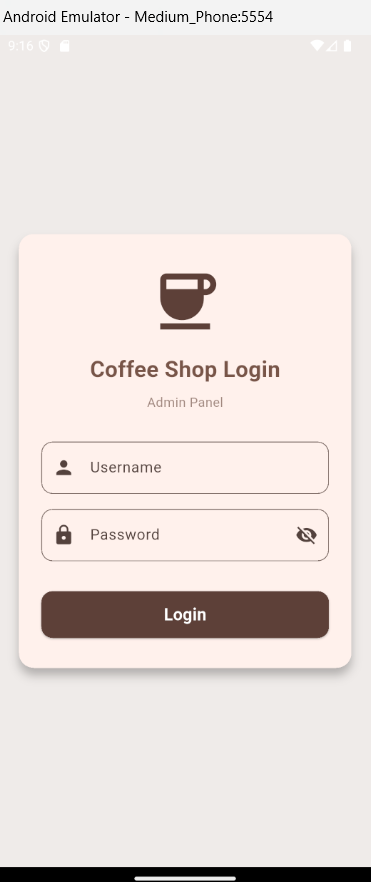
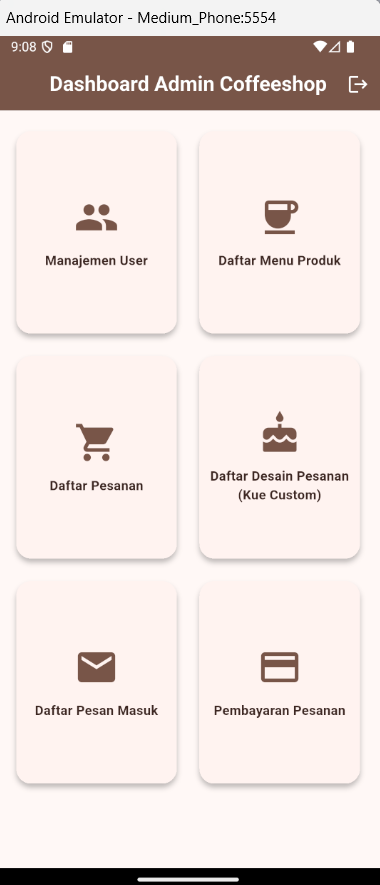
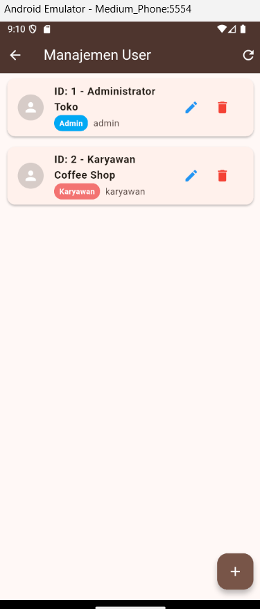
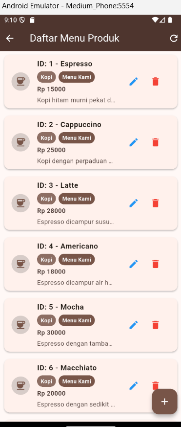
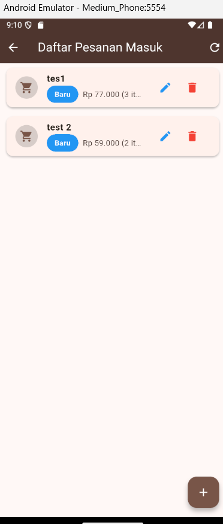
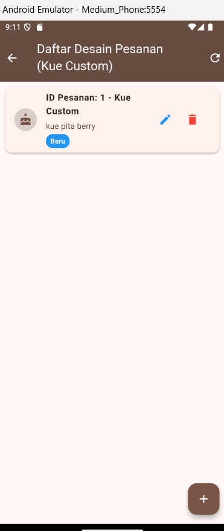
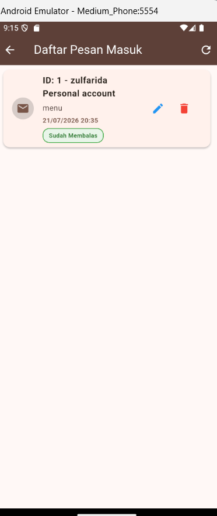
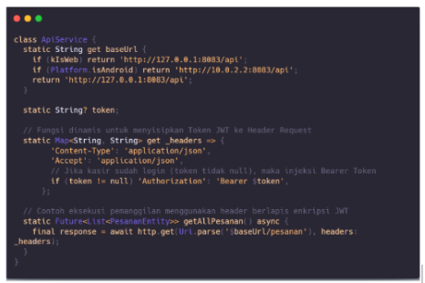
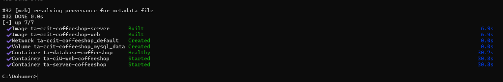
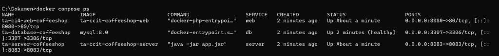

# Classic Coffee Admin & Cashier App

Classic Coffee Admin & Cashier App — A cross-platform Flutter application tailored for administrators and employees, facilitating live order queue processing, custom cake reviews, and transaction updates.

## Main Features

- **User Management:** Direct management of employee and admin accounts (add, edit, delete) with access control permissions.
- **Product Menu List:** Management of coffee, non-coffee, and pastry menu data (add, edit, delete).
- **Order Queue Processing:** Real-time monitoring of incoming customer orders.
- **Custom Cake Order Designs:** Review and management of custom cake design orders submitted by customers.
- **Payment Confirmation:** Cashier module to instantly verify customer payments.
- **Scroll Position Persistence:** The scroll position of data lists remains intact and does not jump to the top when refreshing, adding, or deleting data.

## CRUD Operations Description

This Flutter application features CRUD (Create, Read, Update, Delete) modules connected to a Spring Boot server:

1. **User Management Module (Complete CRUD):**
   - **Create:** Add a new user account (name, username, password, and access level).
   - **Read:** Display the list of all employee/admin accounts in the system.
   - **Update:** Update user data (name, username, password, or access rights).
   - **Delete:** Permanently delete a user account from the database.
2. **Product Menu List Module (Complete CRUD):**
   - **Create:** Add new coffee/pastry products (product name, category, section, price, description).
   - **Read:** Display the list of all active menus available to customers.
   - **Update:** Modify product detail information (name, price, description, etc.).
   - **Delete:** Permanently delete a product menu from the system.
3. **Order Queue & Payment Module (Update & Read):**
   - **Read:** Read incoming order data and customer payment statuses.
   - **Update:** Change order processing status (from new to processing/completed) and verify transaction payments.
   - **Delete:** Remove order data from the queue list if cancelled.
4. **Custom Cake Order Design Module (Complete CRUD):**
   - **Create:** Create new design order data.
   - **Read:** Display the list of custom cake design submissions from customers.
   - **Update:** Update the processing status details of custom cake designs.
   - **Delete:** Remove design data from the review list.

## Technology

- **Framework:** Flutter (Dart)
- **State & Data Persistence:** Flutter State Management, Integration Service
- **Local Storage:** SQLite / Database Helper
- **API Client:** HTTP Client integrated with Spring Boot Server

## Docker Architecture (Backend & Web)

The supporting systems for this application (Backend and Web Frontend) have been containerized using **Docker**. The system runs on three main interconnected containers:

1. **`ta-database-coffeeshop`**: MySQL Container (Port `3307:3306`) storing all application data.
2. **`ta-server-coffeeshop`**: Spring Boot backend container (Port `8083:8083`) connected to the Flutter app via API.
3. **`ta-ci4-web-coffeeshop`**: CodeIgniter 4 frontend container (Port `8080:80`) for customers.

Using `docker-compose`, the entire supporting environment for this Flutter application can be built and run simultaneously.

## Installation & Running Guide

Before running the Flutter application, ensure the Server and Web are running using Docker.

### A. Running Server & Web (using Docker)

Open **Command Prompt (CMD)**, then type the following command:

```cmd
cd C:\Dokumen
docker compose up -d --build
```

> **Command Explanation:**
> - `cd C:\Dokumen` $\rightarrow$ Navigate to the Docker Master folder location.
> - `up -d` $\rightarrow$ Start all containers in the background (preventing CMD from locking).
> - `--build` $\rightarrow$ Ensure Docker builds the latest code version of your Web & Server.

- Check Container Status: `docker compose ps`
- View Server Logs (Real-time): `docker compose logs -f`
- Stop the System: `docker compose down`

### B. Running the Flutter Application

1. Ensure the Flutter SDK is installed on your computer.
2. Connect a physical Android device or launch an Android Emulator.
3. Clone this repository to your local directory.
4. Run flutter pub get to download dependencies:
   ```bash
   flutter pub get
   ```
5. Run the application on an active emulator or device:
   ```bash
   flutter run
   ```

## Deployment / Release via GitHub

To distribute the Flutter application (Android) via GitHub, you can create a release APK file using the **GitHub Releases** feature:

### APK Release Creation Steps
1. Compile the Flutter application into release mode to generate the APK file:
   ```bash
   flutter build apk --release
   ```
2. The compiled APK file will be saved in the `build/app/outputs/flutter-apk/app-release.apk` folder.
3. Open your GitHub repository page, then select the **Releases** menu on the right side of the page.
4. Click **Create a new release** (or Draft a new release).
5. Set a new version tag ((e.g., `v1.0.0`) and your release title.
6. Upload the `app-release.apk` file to the available release binary upload section.
7. Click **Publish release** to share the APK installation file with other users.

---

## Documentation & Demo

The following is a visualization of the Flutter application interface on an Android emulator:

| Feature | Documentation Preview | Description |
| --- | --- | --- |
| **Login Page** |  | Application login page for Admins and Employees. |
| **Main Menu Dashboard** |  | Admin main menu page containing application management navigation options. |
| **User Management Page** |  | Employee account data and access level management interface. |
| **Product Menu List** |  | Coffee and pastry product data management interface. |
| **Incoming Order List** |  | Regular customer order queue entering the system. |
| **Custom Design Orders** |  | Review list of custom cake designs sent by customers. |
| **Incoming Message List** |  | Review list of incoming messages/feedback from customers. |
| **Payment Confirmation** |  | Cashier module for verifying order payments. |
| **JWT Injection Code Snippet (ApiService)** |  | Dart algorithm reading the JWT token from memory and injecting it into the Bearer header of every API request. |
| **Docker Build & Up** |  | Image compilation and simultaneous container initialization process using `docker compose up -d --build`. |
| **Container Status (CLI)** |  | Verification of running containers (Web, Server, DB) along with port mappings via `docker compose ps`. |
| **Docker Desktop UI** |  | Visual management interface for containers, resource usage, and logs via Docker Desktop. |
